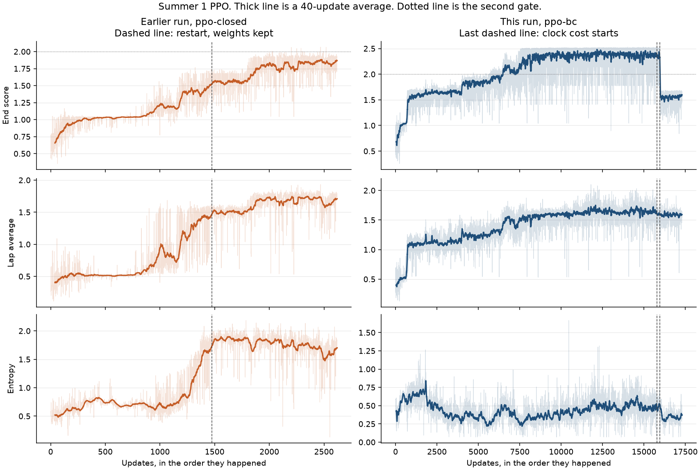
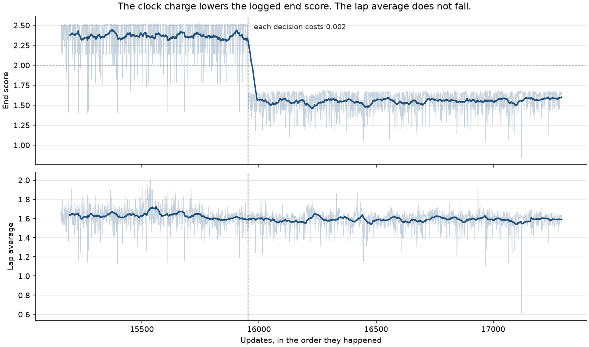

# What training the car showed

The goal is one finished lap of Summer 1. Progress 1 is the first gate. There are three gates, so a finish is progress 4. No lap has finished.

Each decision is one of nine holds: gas, brake, steer, and the combinations, for 50 ms. The policy sees nineteen numbers plus the previous button: position, velocity, acceleration, heading, how many wheels are down, meters of road left to the side, and where the next gate is. Reward is the change in progress, a bonus for passing a gate, and a penalty of 0.002 for each decision.

## A straight line of gas is the bar

Holding gas and nothing else reaches progress 0.539 in 5.0 s and beaches at about x=244.5, z=-3.6. Every other constant hold stalls or falls at the start. The best of those is steer-right with gas, progress 0.045.

The track is drivable. The opening is not a wall. Gas alone takes the first bend and then runs out of road because the line is straight.

## The same button plan now repeats

The physics worker used to stamp each button with wall-clock time. After the worker had been alive for a while, a steer landed thousands of frames late, so the same plan drove a different line. Buttons are stamped on the simulation frame now. Replaying a plan three times matches to the reported digits. `runs/hold/plan.json` is from before that fix. Do not replay it.

## Scripted taps get past the first gate and then fly

With the stamp fixed:

| line | progress | how it ended |
| --- | --- | --- |
| gas the whole way | 0.539 | beached at 5.0 s |
| steer left while progress is 0.35–0.40, otherwise gas | 1.155 | fell at x≈126, y≈47, 7.40 s |
| that tap, plus steer left while progress is 0.55–0.70 | 1.237 | fell at x≈94, y≈47, z≈9, 7.10 s |

The second line is past the first gate. A third tap does not land the jump. Steering, coasting, and braking were tried from progress 0.70 to 1.50. After progress 1.05 the car is in the air, and a steer does nothing. A short brake on the lip still falls around 1.16–1.23. A longer brake sticks at 0.685 and never reaches the jump.

The jump is the road itself. Gate 0 is at x=180, y=55. The next piece is at x=140, y=45. The saved line leaves the lip near 190 km/h, still near y=55 when it reaches x=140, about 10 m above the landing and off to the side.

## PPO and SAC, before this observation

Three seeds, 60 updates, four laps per update. The number is the mean progress of the steps in an update.

| run | best | last | what the policy did |
| --- | --- | --- | --- |
| PPO, bias toward straight gas | 0.199 ± 0.022 | 0.081 ± 0.023 | mixed gas and the two steered-gas holds |
| SAC, entropy target `0.5 log\|A\|` | 0.158 ± 0.021 | 0.017 ± 0.022 | locked onto a bad chord. Critic stayed finite. |
| SAC, entropy target `0.98 log\|A\|` | 0.197 ± 0.062 | 0.024 ± 0.013 | stayed near uniform. Critic loss grew past 800. Alpha rose to 3.64. |

Constant gas at 0.539 was still ahead of every learned policy. Logs: `runs/w-bias-seeded`, `runs/sac-seeded`, `runs/sac-target98`.

## SAC on the nineteen-number state

### The randomness knob ran away

Target `0.98 * log(9)`, which is 2.153. A fully random policy over nine buttons has entropy 2.197, so the target sits on the ceiling. The knob (alpha) was trained with Adam. A miss of 0.001 still takes a full step, and entropy has almost no room to rise and bring the knob back down. It pinned at 7.39, the clamp.

Each step then added about `alpha * entropy` to the critic's target. With discount 0.99 that bonus is worth hundreds of points. The driving reward is about 0.002 per step, plus progress. Over about 130 updates the critic error passed 2,000. Progress stayed at 0. The car sat out the 90 s clock at the start. Log: `runs/sac-blowup`.

### The knob fell to zero and the car picked brake and right

The target was lowered to `0.6 * log(9)`, about 1.32, which is low enough that one button can stay down. The knob was switched to a small SGD step so a tiny miss cannot slam it into the clamp.

The critic stayed calm. Entropy stayed near 2.15, so the car was still pressing all nine buttons, and the knob fell from 0.20 to about 0.009 because entropy was still above the target. Around update 80 the mean progress reached 0.31. That checkpoint is `runs/sac/best.pt`. It is the farthest a learned policy got in this session, and it is still short of holding gas.

Then the policy went to a single button. At the spawn that button was brake and right, with probability 1. The laps died at the start in about 8 s. The critic error jumped to about 300. Alpha was near zero, so it could not try gas again. The run was stopped there.

A random policy almost never holds gas for the hundred decisions a straight line needs. One tap of gas pays less than the time penalty, so the nine scores stay nearly flat. When the knob is near zero, the smallest wobble picks a button and the car never lets go.

## What the trainer is now

PPO. The actor and the critic do not share weights. The critic is trained on the discounted return of the environment reward. The actor moves toward buttons whose return beat what the critic expected. There is no temperature inside the critic's target, which is the piece that drowned the road in both SAC runs.

This is not a claim that the lap will finish. The earlier PPO runs stalled near progress 0.20. It is the learner whose score is the reward we actually wrote down.

`python scripts/train.py` writes `runs/ppo-reward`. It will not load `runs/summer1` or `runs/sac`. `--algo sac` is still there. Do not treat another 60-update sweep of the old setup as a new question.

## Closed-loop PPO, stopped 7 Nov 2026

No lap has finished. The third gate and the finish are still ahead.

The run that was stopped is `runs/ppo-bc`. It copied the human buttons in `runs/bc/best.pt`, then learned by driving. That copy is the PPO actor, 28 numbers in, 9 buttons out. Training ran on 7 Nov 2026 from 07:20 to 20:17 UTC. The weights were kept across two restarts. The update counter went back to 1 each time, so the diagrams are in time order, not in update-number order.

The score is the change in progress while a wheel is on the road. In the air the score stays still. A gate is already inside that number. There is no extra gate bonus. From 19:06 UTC each decision also costs 0.002, which is 0.04 per second.

| piece | when | updates | what it was | last end score | last lap average | last entropy |
| --- | --- | --- | --- | --- | --- | --- |
| 1 | 07:20–18:58 | 15,787 | copied buttons, then PPO | 2.51 | 1.72 | 0.58 |
| 2 | 18:58–19:06 | 166 | same weights, entropy bonus nudged toward 0.6 | 2.17 | 1.47 | 0.43 |
| 3 | 19:06–20:17 | 1,340 | each decision costs 0.002 | 1.64 | 1.64 | 0.38 |

End score is the mean of four laps. Progress 1 is the first gate, 2 is the second, 3 is the third, and 4 is the finish. The lap average stays near 1.6 even when a lap ends past the second gate, because the car spends the start of the lap below 2.

In the first piece the end score first passed 2 at update 4,693 and first passed 2.5 at update 7,636. The highest end score was 2.53 at update 14,019. Of the 8,152 updates from there to the end of that piece, 7,557 were still at or past the second gate, and 10 fell back under 1.2. The last 100 updates of that piece averaged end score 2.38 and lap average 1.63. Entropy stayed near 0.4–0.6. It did not wash out toward a coin flip. A fully random policy over nine buttons has entropy 2.20.

The clock cost is why the logged end score drops to about 1.6 and then sits there. The lap average does not drop. Over the last 100 updates it was 1.59, the same place as before the charge. A 20 second lap pays about 0.8 in time, so the same drive past the second gate logs near 1.6 instead of near 2.4. No update in that last piece has an end score of 2 or more. That is the charge, not a lost gate.

`runs/ppo-bc/best.pt` is update 11,796 from the first piece, lap average 2.10. That is the highest lap average, not the last brain. `runs/ppo-bc/last.pt` is the brain at the stop: update 1,340 of the third piece, lap average 1.64. Both are arch `polytrack-ppo-0.6.3`, Summer 1, keys w a s d.

A chase lap of that last brain, a few updates before the stop: 6 of 10 laps reached the second gate and then stopped. 3 fell at the first gate. 1 stuck before the second gate. The saved lap hops the downhill after the first gate and is still near 100 km/h on the lower road. It reaches the second gate at about 11 seconds, going about 11 km/h, and stops. The flag stays at 2/3.

The earlier run, `runs/ppo-closed`, used a larger entropy bonus. Entropy climbed from about 0.5 to about 1.8, and the copied driving washed out. Its first piece, 1,473 updates, never reached an end score of 2. After a restart that kept the weights, 8 updates did. The best of those is update 997, end score 2.07, lap average 1.93, saved as `runs/ppo-closed/best.pt`. `runs/ppo-closed/last.pt` is update 1,148, lap average 1.74. No lap finished there either.

The thick line is a 40-update average. The faint line is every update. Dashed lines are restarts. The logs are `runs/ppo-bc/log.csv` and `runs/ppo-closed/log.csv`.
